

  <a href="https://d1v4nchik.github.io/DPBusinessManagement/">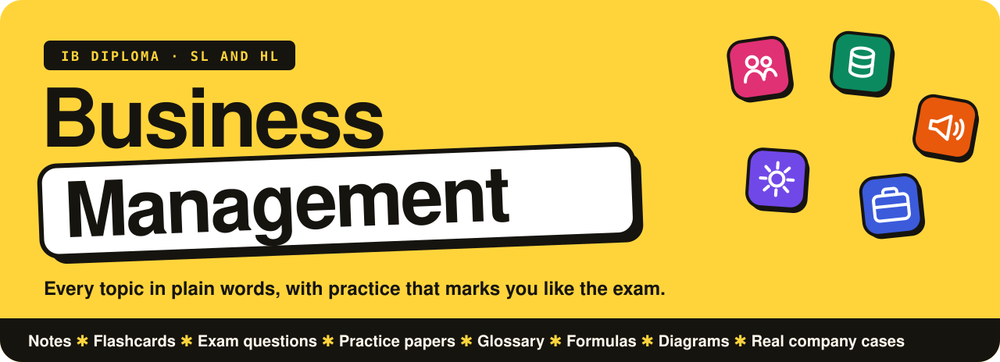</a>

  
  &nbsp;
  

<a href="https://d1v4nchik.github.io/DPBusinessManagement/about.html"><b>See what's inside, for students and teachers &rarr;</b></a>

Free &nbsp;&middot;&nbsp; No sign-up &nbsp;&middot;&nbsp; No ads &nbsp;&middot;&nbsp; Works on phones, tablets and laptops

 

  <picture>
    <source media="(prefers-color-scheme: dark)" srcset=".github/screenshots/home-dark.png">
    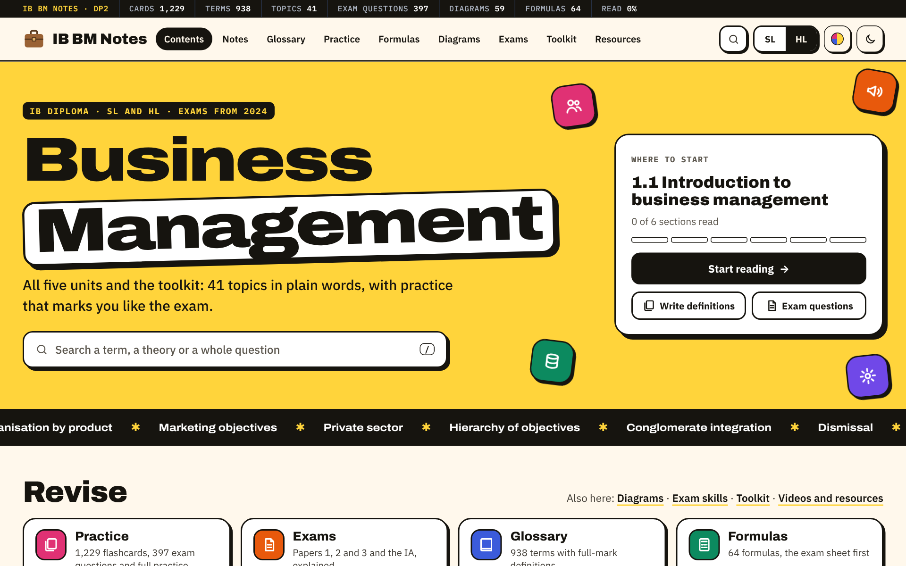
  </picture>

 

Clear, friendly revision notes for IB Diploma Business Management, SL and HL. Every topic is explained in everyday language first and exam language second, with real companies to show how each idea plays out, so you understand it before you learn how to write it for marks. When you're ready, test yourself with flashcards, exam-style questions and full practice papers, all in one place.

You don't need to download anything or make an account. Just [open the notes](https://d1v4nchik.github.io/DPBusinessManagement/) and start.

## Getting started

<table>
  <tr>
    <td width="33%" valign="top">
      STEP 1 
      <b><a href="https://d1v4nchik.github.io/DPBusinessManagement/">Open the notes</a></b> 
      It's a normal website, so it works on school laptops and your phone.
    </td>
    <td width="33%" valign="top">
      STEP 2 
      <b>Choose SL or HL</b> 
      Use the switch at the top. If you're SL, the HL-only parts stay out of your way.
    </td>
    <td width="33%" valign="top">
      STEP 3 
      <b>Pick a topic</b> 
      Read the notes, then try the flashcards and exam questions. Your progress saves by itself.
    </td>
  </tr>
</table>

Stuck on a word? Press <kbd>/</kbd> on any page to search the notes, the glossary and every question.

## What's inside

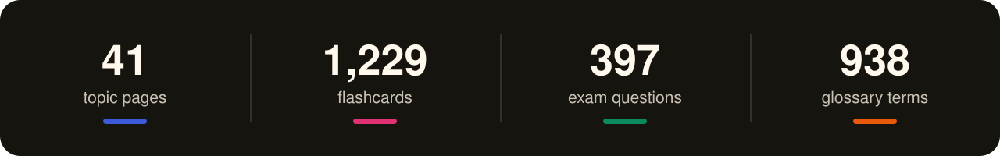

Totals for HL. SL has 29 topic pages, 829 flashcards and 287 exam questions.

<table>
  <tr>
    <td width="50%" valign="top"><b>Notes you can actually follow</b> Every topic starts with what it's about, then each section has a plain explanation, an everyday comparison and the exam definition.</td>
    <td width="50%" valign="top"><b>Cheat sheet or textbook</b> Revise from the short cheat-sheet version, or switch to the textbook version for full explanations and tables written in short sentences.</td>
  </tr>
  <tr>
    <td valign="top"><b>Real company cases</b> 39 real company cases, from Innocent to Carillion, annotated with the Not DEAF method (nature, decision, existing problems, aims, finance). Links in the notes jump straight to the evidence.</td>
    <td valign="top"><b>Flashcards and games</b> 1,229 cards with Learn, Write, Test and Match modes, plus quick games for when you need a break.</td>
  </tr>
  <tr>
    <td valign="top"><b>Exam questions</b> Exam-style questions grouped around a case, with model answers and markschemes. Annotate the case yourself before you answer.</td>
    <td valign="top"><b>Practice papers</b> Full Paper 1, Paper 2 and HL Paper 3 practice papers built like the real exams, with a timer and markschemes to mark yourself.</td>
  </tr>
  <tr>
    <td valign="top"><b>Formulas and diagrams</b> All 64 formulas, the exam formula sheet first, with worked examples and a number drill. 59 diagrams drawn to scale.</td>
    <td valign="top"><b>Glossary and videos</b> 940 terms with full-mark definitions. Underlined words in the notes show their meaning when you tap them. Over 130 short videos.</td>
  </tr>
</table>

## How to revise with it

1. **Understand it.** Read the topic in the notes. If a part feels hard, switch to the textbook version or watch the short video.
2. **Remember it.** Open the flashcards for that topic and go through them in Learn mode until they're all mastered.
3. **Use it.** Annotate the real company case, answer the exam questions for the topic and mark yourself honestly with the markscheme.
4. **Get exam-ready.** Closer to the exam, sit a full practice paper with the timer on.

Your progress is saved on your device, so you can come back to exactly where you stopped.

<h2 id="for-teachers">For teachers</h2>

These notes are free to use with your classes. A few ways teachers use them:

- **Share one link.** Post <a href="https://d1v4nchik.github.io/DPBusinessManagement/">d1v4nchik.github.io/DPBusinessManagement/</a> in your class page. Students don't need an account or an email address.
- **Point to a single topic.** Open the topic you're teaching and copy the address from the address bar. The link opens that exact page.
- **Set revision homework.** Ask students to master the flashcards for a topic, or to answer and self-mark the exam questions for it.
- **Use it in class.** The textbook version, the annotated cases and the diagrams work well on a projector, and there's a light and a dark mode.
- **No data collected.** There are no accounts, ads or tracking. Each student's progress stays in their own browser.

If you spot anything that doesn't match the subject guide, please <a href="https://github.com/d1v4nchik/DPBusinessManagement/issues/new?template=correction.yml">send a correction</a>. It really helps every student using the notes.

<h2 id="study-without-internet">Study without internet</h2>

Revising on the bus, on a plane or somewhere with bad wifi? Choose one of these.

<table>
  <tr>
    <td width="50%" valign="top">
      <b>Install it as an app</b> &nbsp;RECOMMENDED  
      Saves the notes on your device, opens offline, and <b>updates itself</b> whenever you're back online.  
      <b>Laptop</b> &nbsp;In Chrome or Edge, click <i>Install</i> at the right of the address bar. 
      <b>iPhone, iPad</b> &nbsp;In Safari, tap <i>Share</i>, then <i>Add to Home Screen</i>. 
      <b>Android</b> &nbsp;In Chrome, tap the menu, then <i>Install app</i>.
    </td>
    <td width="50%" valign="top">
      <b>Download one file</b> &nbsp;LAPTOPS  
      A single file with all the notes. Double-click it to open it in your browser, with no internet needed.  
      <b>It doesn't update itself.</b> When newer notes come out, it shows a message (if you're online) so you can download it again.  
      <a href="https://github.com/d1v4nchik/DPBusinessManagement/releases/download/offline/ib-bm-notes-offline.html"><b>Download the file</b></a>
    </td>
  </tr>
</table>

Open the notes once with internet before going offline, so the app has time to save everything.

## A quick look

<table>
  <tr>
    <td width="50%">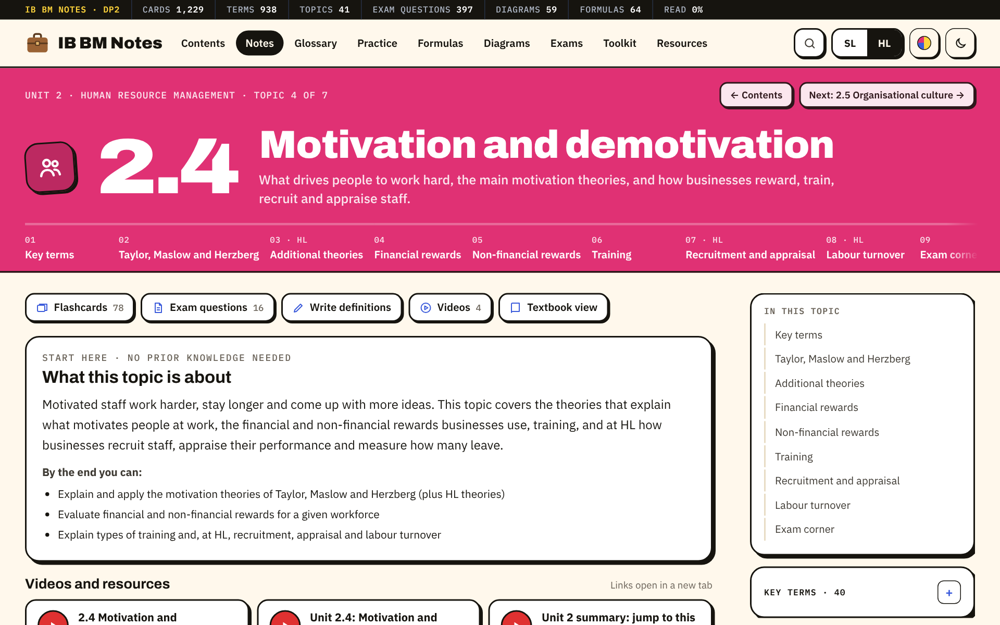 <b>Topic page.</b> Sections, key terms, videos and a contents panel.</td>
    <td width="50%">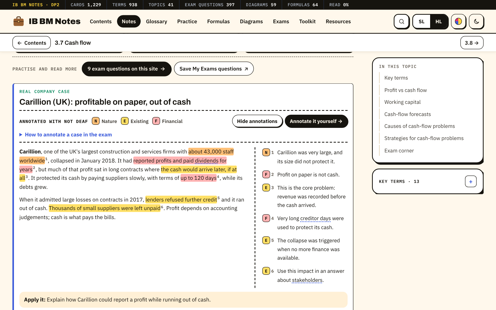 <b>Real company cases.</b> Annotated with Not DEAF, with notes below.</td>
  </tr>
  <tr>
    <td width="50%">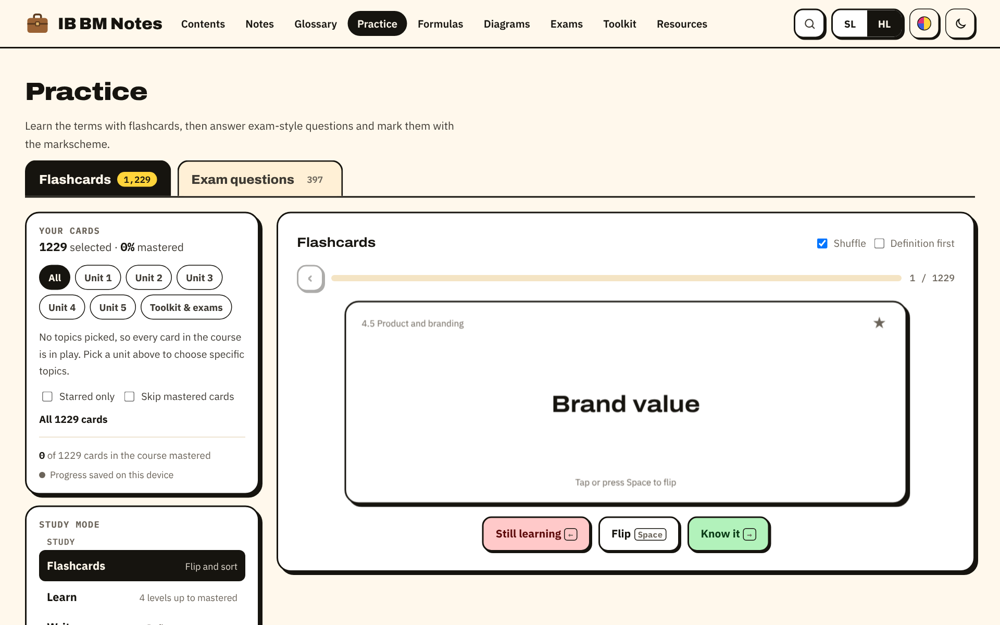 <b>Flashcards.</b> Learn, Write, Test and quick games.</td>
    <td width="50%">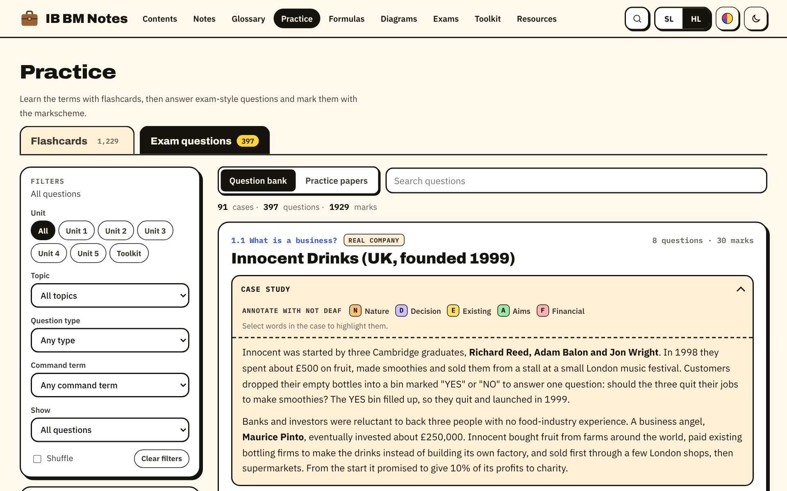 <b>Exam questions.</b> Annotate the case, answer, then mark yourself.</td>
  </tr>
  <tr>
    <td width="50%">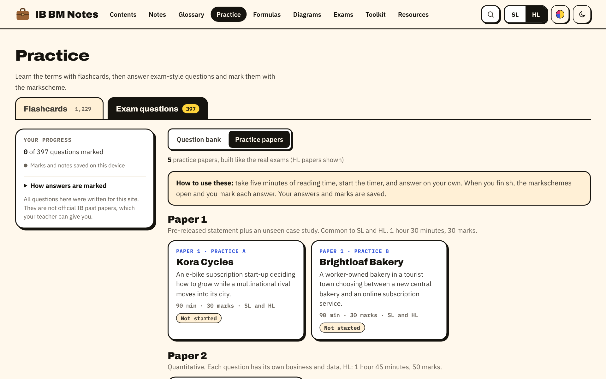 <b>Practice papers.</b> Paper 1, 2 and 3, timed, with markschemes.</td>
    <td width="50%">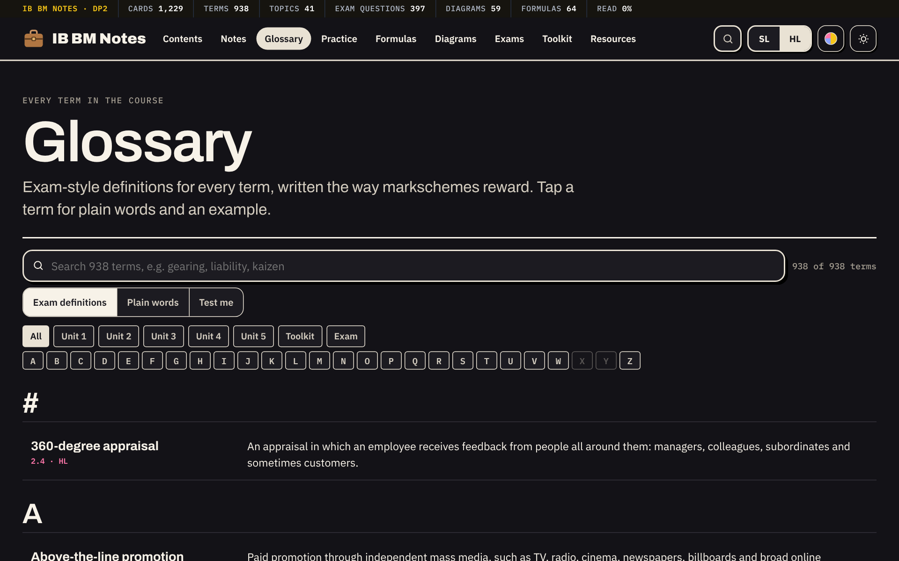 <b>Glossary.</b> Every term with its full-mark definition (dark mode).</td>
  </tr>
</table>

  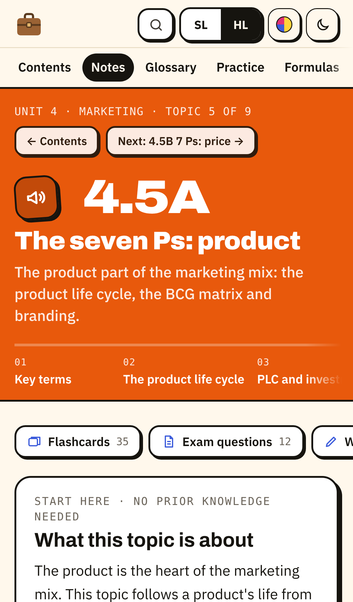
  &nbsp;&nbsp;
  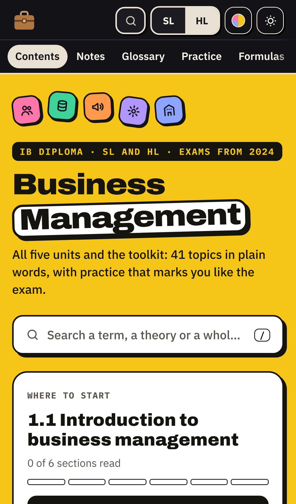

## Questions

<b>Do I need a GitHub account?</b>

 
No. This page is just where the notes are stored. To study, <a href="https://d1v4nchik.github.io/DPBusinessManagement/">open the notes</a>. You only need a free GitHub account if you want to send a correction.

<b>Is it really free?</b>

 
Yes. No payments, no ads and no account.

<b>Where is my progress saved?</b>

 
In your browser, on the device you're using. Nobody else can see it, and your laptop and phone keep separate progress.

<b>Which topics does it cover?</b>

 
The whole IB Diploma Business Management course (first assessment 2024), SL and HL, including the business management toolkit.
  

| Unit | | Topics |
| :--- | :--- | :--- |
|  | Introduction to business management | 1.1 What is a business? · 1.2 Types of business entities · 1.3 Business objectives · 1.4 Stakeholders · 1.5 Growth and evolution · 1.6 Multinational companies |
|  | Human resource management | 2.1 Introduction to HRM · 2.2 Organisational structure · 2.3 Leadership and management · 2.4 Motivation and demotivation · 2.5 Organisational culture **HL** · 2.6 Communication · 2.7 Employee relations **HL** |
|  | Finance and accounts | 3.1–3.2 Finance and its sources · 3.3 Costs and revenues · 3.4 Final accounts · 3.5 Profitability and liquidity ratios · 3.6 Debt/equity ratios **HL** · 3.7 Cash flow · 3.8 Investment appraisal · 3.9 Budgets **HL** |
|  | Marketing | 4.1 Introduction to marketing · 4.2 Marketing planning · 4.3 Sales forecasting **HL** · 4.4 Market research · 4.5A 7 Ps: product · 4.5B 7 Ps: price · 4.5C 7 Ps: promotion and place · 4.5D 7 Ps: services and the mix · 4.6 International marketing **HL** |
|  | Operations management | 5.1 Role of operations · 5.2 Operations methods · 5.3 Lean production and quality **HL** · 5.4 Location · 5.5 Break-even analysis · 5.6 Production planning **HL** · 5.7 Crisis management **HL** · 5.8 Research and development **HL** · 5.9 Management information systems **HL** |
|  | Business management toolkit | SL and HL tools · HL-only tools **HL** |

**Also:** Exam skills for Papers 1, 2 and 3 and the internal assessment · Formulas · Diagrams · Videos and resources

<b>Is this official IB material?</b>

 
No. These are independent study notes, not made by, endorsed by or connected to the International Baccalaureate Organization. "IB" and "International Baccalaureate" are its trademarks. The exam questions and practice papers are written in the style of the exams, not copied from them. Always check against the official subject guide and your teacher.

<b>I found a mistake</b>

 
Thank you. Please <a href="https://github.com/d1v4nchik/DPBusinessManagement/issues/new?template=correction.yml">send a correction</a> with the topic number (for example 3.7) and what's wrong. Have an idea instead? <a href="https://github.com/d1v4nchik/DPBusinessManagement/issues/new?template=suggestion.yml">Make a suggestion</a>. Both need a free GitHub account.

<b>Can I share it?</b>

 
Please do. Send the <a href="https://d1v4nchik.github.io/DPBusinessManagement/">link</a> to classmates and teachers. The notes are &copy; d1v4nchik, all rights reserved, so share the link rather than copying, reposting or selling the content.

 

<b>Good luck with your exams.</b>

<a href="CONTRIBUTING.md">Help edit the site</a> &nbsp;&middot;&nbsp; Also by me: <a href="https://d1v4nchik.github.io/dpcomputerscience27/">IB Computer Science notes</a>

